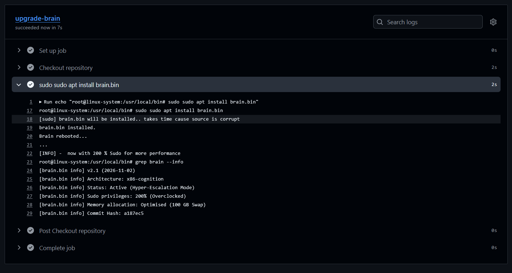

# brain.bin – Handcrafted GitHub Workflow Meme

> *Just a meme secured with a cryptographic timestamp to prove real engineering over AI-generated noise.*

---

### From Idea to Execution

**Concept:** `sudo sudo apt install brain.bin`  
**Execution:** 100% Native GitHub Actions Execution Environment  
**Timestamp:** 2026-11-02  

Played with AI... for a meme. Then I remembered most platforms don't like AI-Memes, so I started thinking... and handcrafted a real log :D  for my meme

#### First Idea

### Handcrafted needed for feeling

  

---

### Verification & Legitimacy
This log was generated directly by running a custom GitHub Actions workflow in a live runner environment.  

- **Commit Hash Verification:** `${GITHUB_SHA:0:7}`
- **Sudo Mode:** 200% (Overclocked)
- **Status:** Active (Hyper-Escalation Mode)
